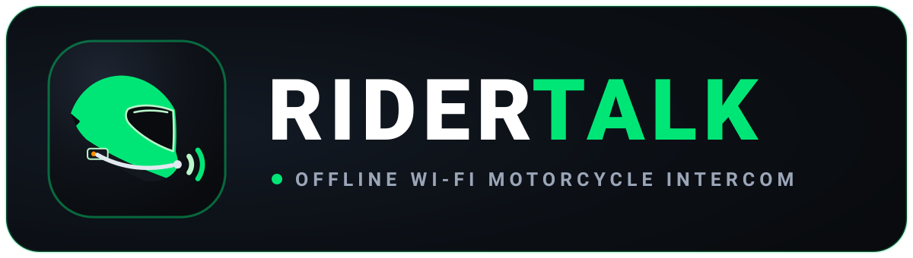
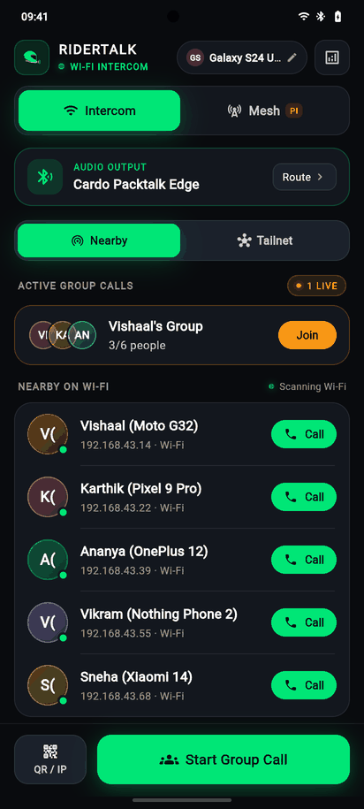
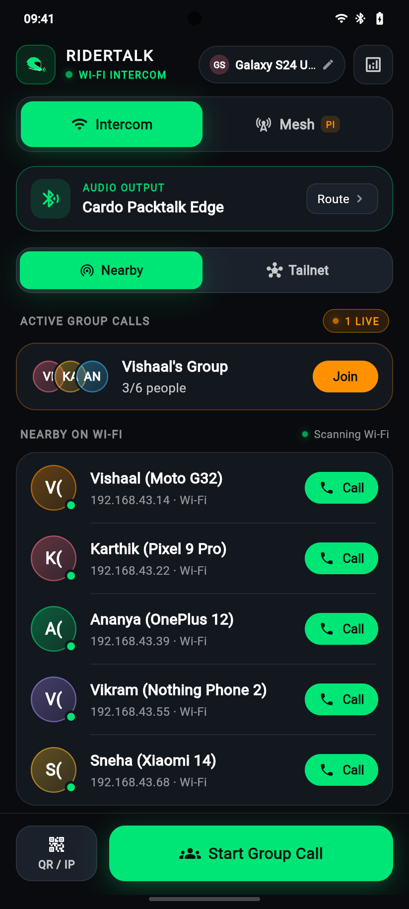
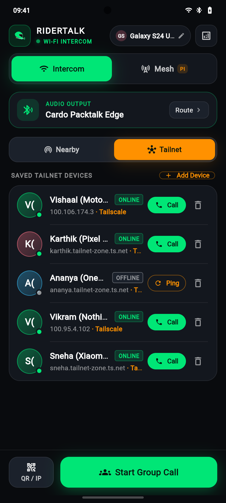
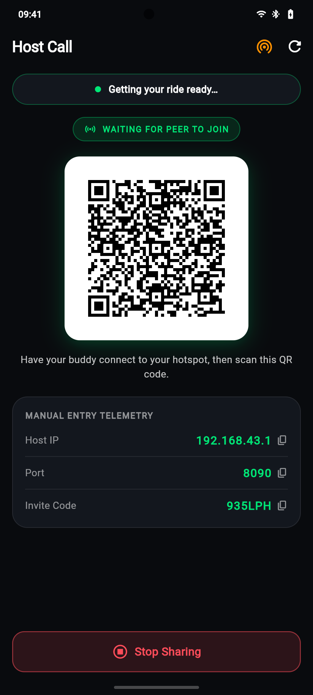
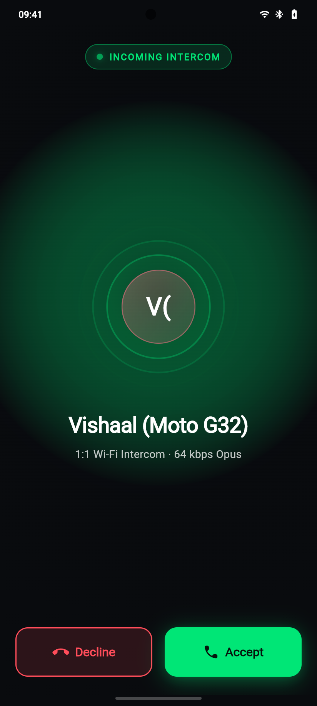
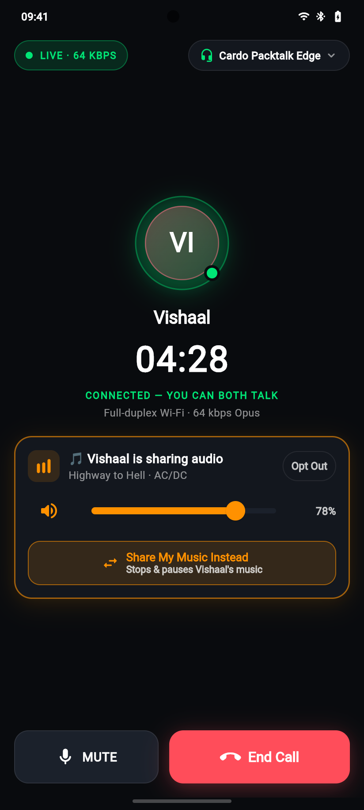
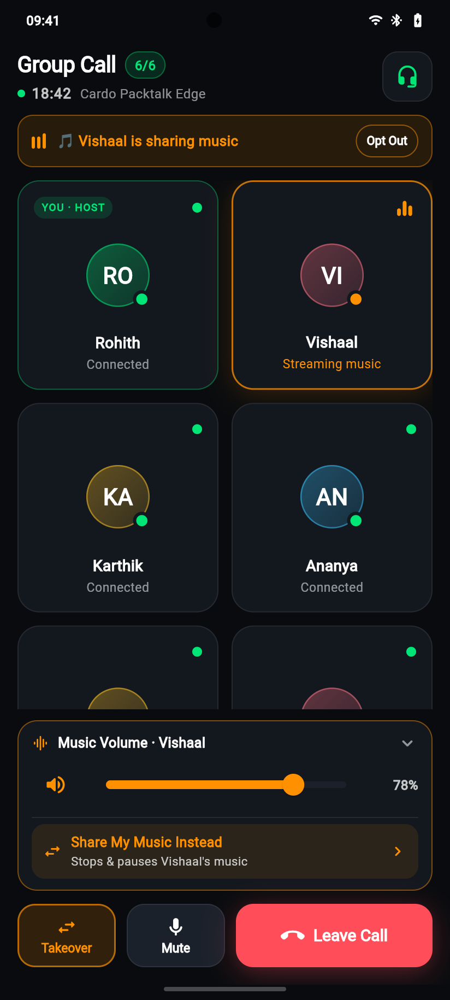
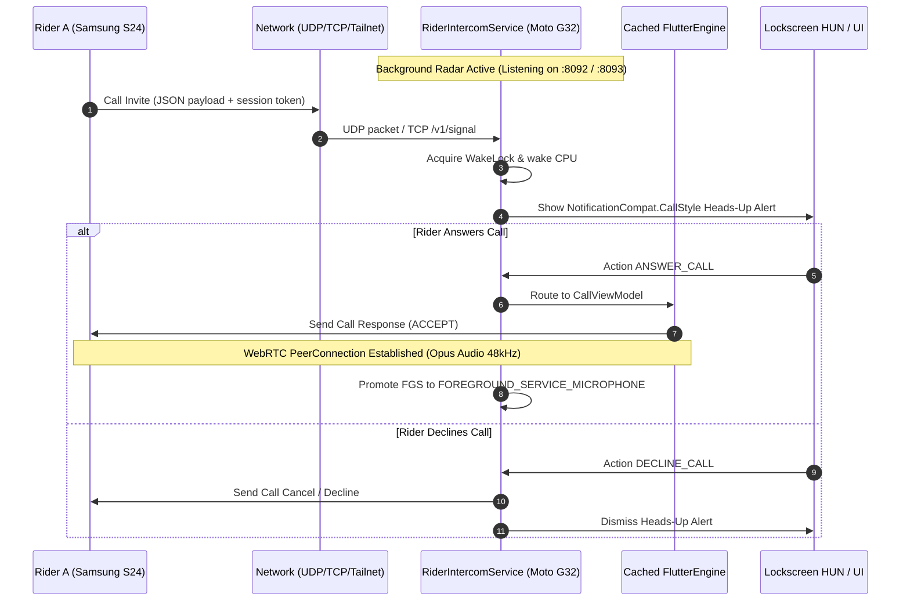

# RiderTalk 🏍️🎙️

<p align="center">
  
</p>

<p align="center">
  <strong>High-definition, full-duplex motorcycle intercom and system audio sharing for Android.</strong><br/>
  Engineered for riders wearing full-face helmets and riding gloves. Operates 100% offline over personal hotspots with zero cellular service, and across long distances over encrypted Tailscale mesh networks (MagicDNS).
</p>

<p align="center">
  <a href="https://github.com/rohithvishaal/RaiderTalk/releases/tag/v3.0.0"></a>
</p>

<p align="center">
  <a href="https://github.com/rohithvishaal/RaiderTalk/releases/tag/v3.0.0"></a>
  
  
  
  
  
</p>

---

## 🎬 RiderTalk v3 Showcase (Interactive Walkthrough)

<p align="center">
  
</p>

<p align="center">
  <em>High-bitrate interactive showcase recorded directly from the production frontend: 6-rider Wi-Fi radar, Tailscale MagicDNS mesh devices, incoming call heads-up notification, 1:1 call with music streaming cockpit (Highway to Hell · AC/DC), 6-user group intercom (2x3 grid), and QR host pairing hub.</em><br/>
  🎥 <em>High-definition video available at <a href="docs/screenshots/ridertalk_showcase_v3.mp4"><code>docs/screenshots/ridertalk_showcase_v3.mp4</code></a>.</em>
</p>

---

## ⚡ Download (v3.0.0 Stable Release)

Grab the production Android APK directly from the [GitHub v3.0.0 Release](https://github.com/rohithvishaal/RaiderTalk/releases/tag/v3.0.0) *(requires Android 12+ / API 31+)*:

| Package | Best For | Architecture | Size | Download Link |
| :--- | :--- | :--- | :--- | :--- |
| **`app-release.apk`** *(Production Stable)* | Universal package for all modern Android phones (Samsung Galaxy, Moto, Google Pixel, OnePlus, Xiaomi, etc.) | `arm64-v8a`, `armeabi-v7a`, `x86_64` | 96.7 MB | [Download v3.0.0 APK](https://github.com/rohithvishaal/RaiderTalk/releases/download/v3.0.0/app-release.apk) |

> 📋 Check the release notes and SHA-256 integrity checksums in [RELEASE_v3.0.0.md](RELEASE_v3.0.0.md), or browse [all GitHub releases](https://github.com/rohithvishaal/RaiderTalk/releases).

---

## 🧭 System Topology & Architecture

RiderTalk turns off-the-shelf Android smartphones into high-reliability intercoms capable of operating in zero-reception backcountry trails or across distributed city convoys:

```text
                                RIDERTALK TOPOLOGY MODES

    [ MODE 1: OFFLINE HOTSPOT STAR ]         [ MODE 2: TAILSCALE MESH (VPN) ]
           (Driver & Pillion)                        (Remote Multi-Bike)

       Rider A (Host Hotspot)                     Rider A (Phone / 4G / Starlink)
        ┌──────────────────┐                            ┌──────────────────┐
        │  Hotspot AP      │                            │ Tailscale Client │
        │  UDP 8092 / 8093 │                            │ 100.122.158.101  │
        └─────────┬────────┘                            └─────────┬────────┘
                  │ Wi-Fi                                         │ Encrypted P2P WireGuard
                  ▼                                               ▼
       Rider B (Client Phone)                     Rider B (Phone / 4G / Starlink)
        ┌──────────────────┐                            ┌──────────────────┐
        │ Connected to AP  │                            │ Tailscale Client │
        │ Full-Duplex Opus │                            │ 100.106.174.3    │
        └──────────────────┘                            └──────────────────┘

                       [ MODE 3: HARDWARE PI MESH (v3 Roadmap) ]
                                (Highway Long-Range Chains)

       [Bike 1: Pi 0 2W] ◄──────BATMAN-adv 802.11s (400-600m)──────► [Bike 2: Pi 0 2W]
               ▲                                                             ▲
               │ Local Wi-Fi                                                 │ Local Wi-Fi
        [Bike 1: Phone]                                               [Bike 2: Phone]
```

1. **100% Offline Hotspot Star (Mode 1):** Driver and pillion or tight trail groups communicate over a direct Android Wi-Fi Hotspot with **zero cellular connectivity, SIM card requirements, or internet access**.
2. **Tailscale Wide-Area Mesh (Mode 2):** Riding buddies separated by traffic, distance, or highway cruising connect over an encrypted WireGuard mesh VPN using Tailscale MagicDNS hostnames or `100.x.y.z` carrier-grade private IPs.
3. **Hardware Pi Mesh (Mode 3 Roadmap):** Long-distance bike-to-bike dynamic relays powered by low-cost Raspberry Pi Zero 2 W hardware nodes running BATMAN-adv 802.11s mesh networking.
4. **Persistent 24/7 Radar Standby:** A dedicated background service (`FOREGROUND_SERVICE_CONNECTED_DEVICE`) keeps peer discovery active when the phone is locked in a pocket, waking the screen with a lockscreen Heads-Up Call Alert. Includes a quick **"Stop Radar"** notification action to quit the app entirely on demand.
5. **Jitter-Free Music Sharing & Dynamic Voice Ducking:** Any rider can stream system audio (Spotify, Apple Music, YouTube Music) into the intercom call with an expanded 40-frame jitter buffer. When either rider speaks, the music automatically ducks to 20% volume within 150ms and smoothly recovers once speech stops.
6. **Bluetooth Helmet Audio Routing:** Connects natively to Bluetooth motorcycle helmet communication systems (Cardo Packtalk, Sena, FreedConn) via Android 12+ CommunicationDevice routing with automatic disconnect safety muting.

---

## 📱 Mobile UI Gallery (100% Production Parity)

All mockups below represent the exact production UI widgets (`TarmacTheme`, `TarmacColors`, and `TarmacTypography`) running with **6 active riders** (Rohith as Host + Vishaal, Karthik, Ananya, Vikram, and Sneha).

### 1. Peer Radar & Tailnet Mesh Discovery

Nearby riders on local Wi-Fi or hotspots appear instantly on the radar. Remote riders connected via Tailscale mesh display live MagicDNS resolution, IP address, and real-time `ONLINE` status badges.

| Local Wi-Fi Radar (6 Riders) | Tailnet Mesh Devices (MagicDNS) | QR Code & Manual Pairing Hub |
| :---: | :---: | :---: |
|  |  |  |
| *Active group ride detection + 5 nearby peers (6 riders total)* | *Tailscale mesh devices with live online badges and MagicDNS* | *Scannable QR code & 6-char manual telemetry code* |

---

### 2. Tactical Intercom & High-Bitrate Music Sharing

Designed with oversized touch targets and high-contrast telemetry for quick glances through helmet visors and easy taps with riding gloves.

| Incoming Call Heads-Up Alert | 1:1 Intercom & Music Cockpit | 6-Rider Group Intercom Grid |
| :---: | :---: | :---: |
|  |  |  |
| *Concentric radar rings with oversized Answer & Decline buttons* | *Streaming Highway to Hell · AC/DC with volume slider & takeover* | *Full 2x3 participant grid with live music badges & host tag* |

---

## 🚀 Core Features & Technical Deep-Dive

### 🎙️ 1. 100% Offline Full-Duplex Intercom
* **Simultaneous Speaking & Listening:** No push-to-talk (PTT) delay; talk naturally like a phone call or wired cockpit intercom.
* **WebRTC Opus Stack:** High-definition 48 kHz voice encoded at 64 kbps over direct local UDP sockets for sub-20ms latency.
* **Hardware Acoustic Processing:** Utilizes Android's hardware Acoustic Echo Cancellation (AEC), Automatic Gain Control (AGC), and Noise Suppression (NS) to cancel wind and engine noise.

### 🌐 2. Tailnet Wide-Area Mesh Intercom
* **MagicDNS & IPv4 Routing:** Call riding buddies across towns or highways using Tailscale hostnames (`peer.tailnet-zone.ts.net`) or Tailscale IPs (`100.x.y.z`).
* **Authoritative Quad-100 DNS Fallback:** Bypasses Android Private DNS (DNS-over-TLS) restrictions by performing direct UDP lookups against Tailscale's Quad-100 DNS resolver (`100.100.100.100:53`).
* **Unicast Keep-Alive Pinning:** Tailscale suppresses subnet broadcasts (`255.255.255.255`). RiderTalk automatically pins saved Tailnet peers, sending 1.5-second unicast UDP beacons so remote riders remain visible.
* **Dual-Interface Discovery:** Devices active on both Wi-Fi and Tailscale appear as distinct entries (`${id}_tailscale` and `${id}_wifi`), enabling riders to choose local Wi-Fi or mesh routing.
* **Reciprocal Device Saving & Live 20s Probing:** Automatically saves peer information on connection, probing saved peers every 20 seconds via TCP HTTP (`:8093`) with real-time `ONLINE` badges and arrival alerts.

### 🛡️ 3. Persistent 24/7 Radar & Instant "Stop Radar" Exit
* **Sticky Foreground Service:** `RiderIntercomService` runs with `FOREGROUND_SERVICE_CONNECTED_DEVICE` and `PowerManager.PARTIAL_WAKE_LOCK`. Sockets and listeners stay active when the phone is locked or riding in a pocket.
* **Persistent Cached FlutterEngine:** Caches the FlutterEngine (`CACHED_ENGINE_ID = "ridertalk_engine"`), routing Android back-navigation to `moveTaskToBack(true)` to prevent accidental background teardown.
* **Lockscreen Heads-Up Call Alert:** High-priority system **Heads-Up Notification** (`NotificationCompat.CallStyle.forIncomingCall`) wakes the display with caller identity and prominent **"Answer"** (green) and **"Decline"** (red) action buttons for 1-tap answering with riding gloves.
* **"Stop Radar" Exit Control:** Includes a dedicated **"Stop Radar"** action directly on the notification card to cleanly tear down the service, destroy the engine cache, and completely terminate the app process on demand.
* **Branded Notification Icon:** Uses a custom 24dp vector silhouette of the RiderTalk helmet (`ic_notification.xml`) tinted with Signal Green (`#00E676`) and launcher icon bitmaps via `setLargeIcon`.

### 🎵 4. Jitter-Free Music Sharing & Dynamic Ducking
* **System Audio Capture:** Streams device media audio (Spotify, Apple Music, YouTube Music) using Android's native `AudioPlaybackCaptureConfiguration` and MediaProjection.
* **Expanded Jitter Buffer:** 40-frame playback jitter buffer (~800ms) with a 20-frame soft cap (~400ms), 4-frame prebuffering (80ms), and 3-timeout starvation tolerance (240ms), eliminating audio choppiness over Wi-Fi and Tailnet.
* **4:1 IMA-ADPCM Compression:** Pure Dart compression encodes 20ms stereo audio frames into 970 bytes (<1 MTU packet) with <1ms latency over WebRTC DataChannel.
* **Intelligent Voice Ducking:** Automatically drops shared music volume to 20% within 150ms when either rider speaks, holds for 800ms, and smoothly recovers to 100% once speech stops.
* **Token Mutex Arbitration:** Single-sharer token mutex (`mus_tok_*`) with 4.5s heartbeat eviction prevents conflicting simultaneous music streams.

### 🎧 5. Bluetooth Helmet Headset Audio Routing
* **Motorcycle Helmet Systems:** Routes audio to Bluetooth motorcycle helmet systems (Cardo Packtalk, Sena, FreedConn), wired headsets, or phone speakerphone using Android 12+ `AudioManager.setCommunicationDevice`.
* **Route Loss Safety Policy:** Automatically mutes the microphone and halts media transmission if the Bluetooth headset disconnects while riding, preventing sudden blaring from the built-in phone speaker.

---

## 🔄 Call Handshake & Signaling Architecture



---

## 🛠️ Connection Scenarios

### Scenario 1: Driver & Pillion (Offline Hotspot)
1. **Rider 1 (Driver):** Turn on **Personal Hotspot** in Android settings (mobile data can be off).
2. **Rider 2 (Pillion):** Connect to Rider 1's Wi-Fi hotspot.
3. Open **RiderTalk** on both devices.
4. Nearby riders appear under the **"Nearby"** tab.
5. Tap **"Call"** for 1:1 intercom, or tap **"Start Group Call"** for group ride mode.

### Scenario 2: Shared Local Wi-Fi Router
1. Connect all phones to the same local Wi-Fi router.
2. Open **RiderTalk**.
3. Tap **"Call"** next to the desired rider under the **"Nearby"** tab.

### Scenario 3: QR Code Pairing (Restricted Subnets / AP Isolation)
If the router or hotspot blocks broadcast traffic between clients:
1. One rider taps **"QR / IP"** to display their session QR code.
2. The other rider taps **"Scan QR code"** (or enters the 6-character invite code manually).

### Scenario 4: Tailscale Mesh (Multi-Bike / Remote Convoys)
1. Turn on **Tailscale** on all participating phones.
2. Open **RiderTalk** and switch to the **"Tailnet"** tab.
3. Tap **"+ Add Device"** and enter the peer's MagicDNS name (`peer.tailnet-zone.ts.net`) or Tailscale IP (`100.x.y.z`).
4. The peer appears with a real-time **`ONLINE`** badge.
5. Tap **"Call"** to connect. When connected, RiderTalk automatically saves both devices reciprocally for future 1-tap calling.
6. The app can be placed in the background or locked in a pocket—incoming calls wake the screen with a heads-up notification.

---

## 📊 Technical Specifications

| Parameter | Specification |
| :--- | :--- |
| **Minimum Android Version** | Android 12 (API level 31) |
| **Target Android Version** | Android 15 (API level 35) |
| **Voice Codec** | WebRTC Opus fullband (48 kHz sample rate, 64 kbps, hardware AEC/NS/AGC) |
| **Music Streaming Codec** | 16-bit 48 kHz stereo PCM with 4:1 IMA-ADPCM compression via WebRTC DataChannel |
| **Music Jitter Buffer** | 40-frame buffer (~800ms) with 20-frame soft cap (~400ms) and starvation recovery |
| **Signaling Protocol** | Local WebSocket on port `8090` |
| **Discovery Sockets** | UDP broadcast/unicast on port `8092`, TCP HTTP fallback on port `8093` |
| **Mesh Networking** | Tailscale WireGuard mesh, MagicDNS, Quad-100 UDP DNS fallback (`100.100.100.100:53`) |
| **Foreground Service Types** | `FOREGROUND_SERVICE_CONNECTED_DEVICE`, `MICROPHONE`, `MEDIA_PROJECTION` |
| **Background Architecture** | Cached `FlutterEngineCache`, sticky service (`START_STICKY`), `PowerManager.PARTIAL_WAKE_LOCK` |
| **Call Notifications** | Android `NotificationCompat.CallStyle.forIncomingCall` with Answer/Decline pending intents |
| **Notification Icons** | Branded 24dp silhouette vector (`ic_notification.xml`) + scaled launcher icon bitmap |
| **Exit Control** | Notification action `ACTION_STOP_RADAR` for instant clean teardown |

---

## 💻 Development & Build

### Prerequisites
* [Flutter SDK](https://docs.flutter.dev/get-started/install) (`>= 3.16.0`)
* [Dart SDK](https://dart.dev/get-dart) (`>= 3.2.0`)
* Android SDK (API 35 compileSdk, API 31 minSdk)
* Physical Android devices running Android 12+ for hardware audio routing tests.

### Build & Deploy Commands
```bash
# 1. Clone the repository
git clone https://github.com/rohithvishaal/RaiderTalk.git
cd RaiderTalk

# 2. Install dependencies
flutter pub get

# 3. Run automated tests (865 unit & widget tests)
flutter test

# 4. Multi-device ADB deploy to all connected phones (Debug mode)
powershell -ExecutionPolicy Bypass -File .\deploy.ps1

# 5. Multi-device ADB deploy to all connected phones (Release/Prod mode)
powershell -ExecutionPolicy Bypass -File .\deploy.ps1 -Prod

# 6. Build production standalone release APK
flutter build apk --release
```

---

## 📄 License & Terms

RiderTalk is licensed under the **RiderTalk Non-Commercial & Personal Use License**.

* **Permitted:** Personal, private, educational, and non-commercial motorcycle riding use.
* **Prohibited:** Commercial exploitation, reselling, sublicensing, charging fees for access, or bundling into commercial products.

See [LICENSE](LICENSE) for full legal terms.
